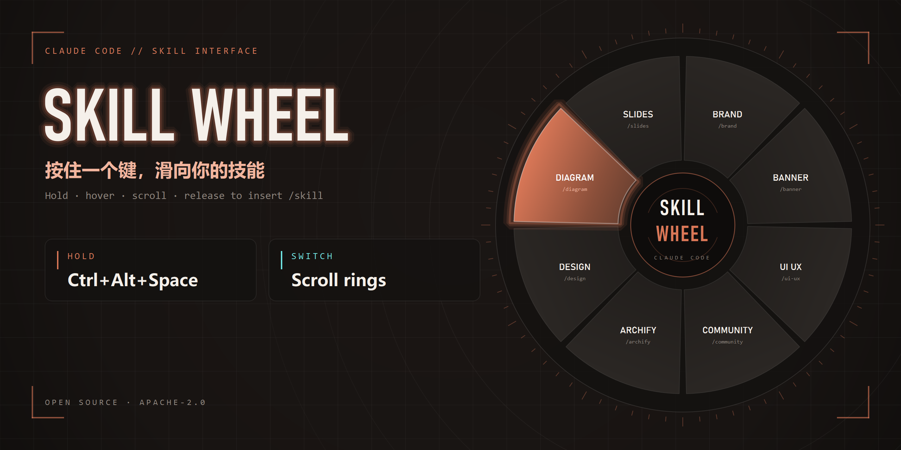
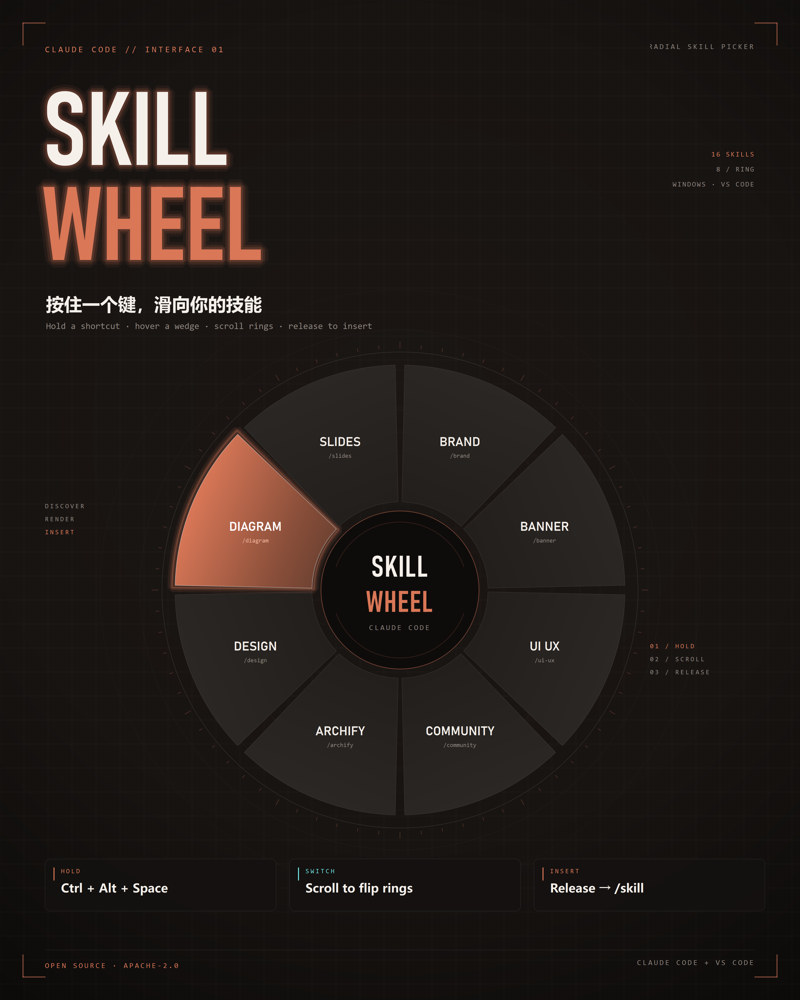

# Skill Wheel



按住 **Ctrl + Alt + Space**（默认，可在配置里改），屏幕上弹出一圈已安装的 Claude Code skills；鼠标滑到哪个扇形，哪个就放大；滚轮切换下一页圆盘；**松开按键**就把 `/skill名 ` 写进 Claude 输入框。鼠标没动就松开 = 取消。

```
        ┌──────────────────────────┐
        │ holding Ctrl+Alt+Space   │
        │      ╭──────────╮        │
        │   ╭──┤  skill  ├──╮     │
        │   │  ╰──────────╯  │     │
        │   │   hover → 放大  │     │
        │   ╰────────────────╯     │
        └──────────────────────────┘
```

## 组成

| 部分 | 作用 |
| --- | --- |
| `overlay/`（Python + PySide6） | 透明置顶圆盘、全局热键、鼠标悬停/滚轮、注入文本 |
| `extension/`（VS Code 扩展） | 随 VS Code 启停 overlay、状态栏、`/focus-claude` 桥 |

VS Code 扩展 API 本身做不了透明悬浮窗，所以圆盘由 Python 层绘制；扩展负责生命周期和聚焦 Claude 输入框。

## 安装（源码）

```powershell
git clone https://github.com/<your-name>/claude-skill-wheel.git
cd claude-skill-wheel
uv venv --python 3.12 .venv
uv pip install --python .venv\Scripts\python.exe -r requirements.txt
powershell -File .\install.ps1
```

`install.ps1` 会把 `extension/` 复制到
`~/.vscode/extensions/ricky.skill-wheel-<version>/`，然后重载 VS Code 窗口。
被执行策略拦住时，先运行
`Set-ExecutionPolicy -Scope Process RemoteSigned` 再执行脚本。

- 配置 / 日志：`~/.claude/skill-wheel/`（`config.json`、`usage.json`、`overlay.log`）
- 技能来源：`~/.claude/skills/*/SKILL.md`

## 启用

1. VS Code 里执行 **Developer: Reload Window**（或重启 VS Code）。
2. 右下角出现 **Skill Wheel** 状态栏；点击可启停。
3. 打开 Claude Code 面板，按住 **Ctrl + Alt + Space**（默认），移动鼠标选 skill，松开。

> 状态栏 / 命令：`Skill Wheel: Start overlay`、`Stop overlay`、`Restart overlay`、`Open config`、`Show logs`。

## 配置

编辑 `~/.claude/skill-wheel/config.json`（改完执行 `Skill Wheel: Restart overlay`）：

| 键 | 默认 | 说明 |
| --- | --- | --- |
| `trigger` | `"ctrl+alt+space"` | 全局触发键。**别用单独的 Alt 组合**（VS Code 会进入菜单访问键模式）；可用 `ctrl+alt+space`、`ctrl+alt+\``、`alt+caps_lock`（后者仍有 Alt） |
| `skillsPerPage` | `8` | 每圈多少个 skill（2–16 比较合适） |
| `radius` | `250` | 圆盘外半径（逻辑像素） |
| `innerRadius` | `118` | 中心圆半径 |
| `insertMode` | `"insert"` | `insert` 用剪贴板粘贴（最稳）；`insert_and_enter` 粘贴并回车；`clipboard` 只复制不注入 |
| `focusClaude` | `true` | 选中后先调用 `claude-vscode.focus` 聚焦 Claude 输入框 |
| `sources.personal` | `true` | 扫描 `~/.claude/skills/*/SKILL.md` |
| `sources.project` | `true` | 扫描当前工作区 `.claude/skills/*/SKILL.md` |
| `sources.plugins` | `false` | 扫描 `~/.claude/plugins/**/skills/**/SKILL.md`（会混入大量市场插件技能） |
| `pins` | `[]` | 置顶技能名，按顺序排在每页最前（跨页时按名字全局排序后分页） |
| `exclude` | `[]` | 隐藏的技能名 |
| `sort` | `"usage"` | `usage` 按使用次数；`name` 按字母 |
| `trackUsage` | `true` | 记录自己的使用次数，影响排序 |
| `dimBackground` | `0.38` | 背景压暗强度 |
| `moveThreshold` | `12` | 鼠标移动超过多少像素才算“选了” |

### 自定义触发键

- 支持修饰键：`alt` / `ctrl` / `shift` / `win`
- 主键：单字符（`` ` ``、`space`、`q`…）或 `caps_lock`、`tab`、`f1`…
- 例：`"ctrl+alt+space"`（默认，避开 Alt 菜单冲突）、`"ctrl+alt+\`"`、`"alt+caps_lock"`
- 触发时组合里的**非修饰键会被系统级拦截**，不会漏进 VS Code。
- **不要用单独的 Alt 当修饰键**：VS Code 在 Alt 按下瞬间就会进入菜单访问键模式，钩子追不回来。

## 圆盘打开时

- 滚轮被系统级拦截：只切换圆盘页，**不会滚动底下的编辑器/网页**；松开后滚轮恢复正常。
- 鼠标不动直接松开 = 取消；移动超过 `moveThreshold` 像素并停在某个扇形上再松开 = 选中。
- 选中后先把 `/skill名 ` 写进剪贴板并粘贴到当前输入框，约 1.2 秒后恢复你原来的剪贴板。

## 加一个新 skill

在 `~/.claude/skills/<目录名>/SKILL.md` 顶部写：

```markdown
---
name: my-skill
description: 一句话说明，会显示在圆盘中心
---

# 正文…
```

下次弹圆盘会自动出现（每次打开都会重新扫描）。

## 排错

| 现象 | 处理 |
| --- | --- |
| 按热键没反应 | 看托盘图标是否在；`~/.claude/skill-wheel/overlay.log` 的 `hotkey armed`；或 `Skill Wheel: Show logs` |
| 状态栏没有 Skill Wheel | 确认重载过窗口；`~/.vscode/extensions/ricky.skill-wheel-0.1.1` 存在 |
| 圆盘出现但选中没写入 | 确认 Claude 输入框可用；`focusClaude` 为 true 时需要扩展在运行；也可试 `insertMode: "clipboard"` |
| 按了组合键但 VS Code 收到反引号 | pynput 钩子被其他键盘软件抢占（输入法/游戏键盘套件），换一个触发键 |
| 圆盘位置偏 / 多屏异常 | 当前版本按光标所在屏幕居中，但半径/中心用逻辑坐标；多屏不同缩放时建议先只用一个屏幕 |

## 开源与路线图

- 许可证：**Apache-2.0**（见 `LICENSE`）
- 首发：GitHub 仓库 + CI 产出的 VSIX（`.github/workflows/ci.yml`）
- 之后：VS Code Marketplace（需 bundle Python 运行时 + publisher 账号）
- 社区技能库：独立圆盘入口，只索引公开来源，导入需确认
  - 设计见 `docs/COMMUNITY_CATALOG.md`
  - 发布清单见 `docs/OPEN_SOURCE.md`
  - 索引在 `catalog/index.json`，用 PR 收录
  - CLI：`.venv/Scripts/python.exe overlay/main.py --catalog`

## 视频

两版介绍视频都可离线生成：Windows SAPI 中文配音 + numpy 配乐 + QPainter 帧 + ffmpeg 编码。

```powershell
# 抖音竖屏 1080x1920，约 48 秒：钩子 → 筛人 → 演示 → GitHub
python assets/make_video_douyin.py --render

# 横版 1920x1080，约 89 秒：完整介绍
python assets/make_video.py --render
```

输出：
- `assets/video/skill-wheel-douyin-50s.mp4`
- `assets/video/skill-wheel-intro.mp4`

（生成物已在 `.gitignore` 中排除。）

想换成你自己的声音：见 [`assets/VOICE.md`](assets/VOICE.md)，替换 8 段 WAV 后 `--reuse-audio --render` 即可。

## 海报



生成脚本：`python assets/make_poster.py`（QPainter，无外部服务）。

## 开发

```bash
# 列出当前会读到的 skills
.venv/Scripts/python.exe overlay/main.py --list

# 不开热键，直接渲染一次并截图（会短暂移动鼠标）
.venv/Scripts/python.exe overlay/main.py --demo --hover 2 --shot demo.png

# 单独跑 overlay（不经过 VS Code 扩展）
.venv/Scripts/python.exe overlay/main.py --workspace "C:\path\to\project"
```

依赖：`pip install -r requirements.txt`。
